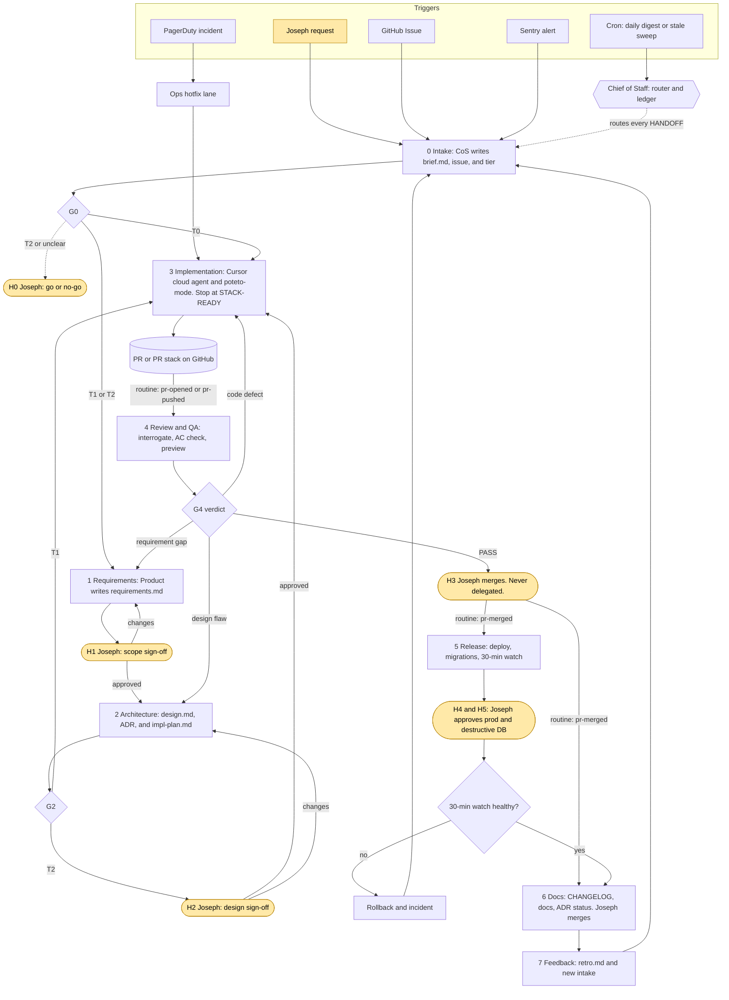

# SDLC Pipeline: Bot Team × Cursor × pstack

| | |
|---|---|
| Owner | Joseph Passalacqua (operator) · Chief of Staff bot (coordinator) |
| Status | **v0.2 foundation.** D1, D2, D3, D4, and D6 are decided. D5, D7, D8, D9, and D10 are still open. |
| Date | 2026-10-19 |
| Pilot repo | [JPassalacqua97/SDLCPipelines](https://github.com/JPassalacqua97/SDLCPipelines) |
| Scope | Every change to a repo Joseph owns, from idea to production to feedback. This repo is the first pilot. |

Decisions recorded for this version:

| # | Decision | Recorded choice |
|---|---|---|
| D1 | Source control | **GitHub.** This repo is the pilot. Origin is not the forge. |
| D2 | Tracker of record | **GitHub Issues.** Linear is not a tracker and not an intake trigger. |
| D3 | Artifact home | **This repo.** `docs/sdlc/<work_id>/` and `docs/adr/`. No Notion mirror. |
| D4 | Merge authority | **Joseph merges every PR** after Reviewer/QA approves. No auto-merge. No merge delegation at any tier, including T0 and docs PRs. Bots never run `shipping` or `autopilot-full`. |
| D6 | Implementation engine | **Cursor cloud agents with the pstack plugin.** Not a vendored copy of the skills. Project enablement is `.cursor/settings.json`. Joseph still installs the plugin in Cursor. |

---

## 0. TL;DR

One pipeline with eight stages. Each stage has one owner bot, one artifact contract, and an exit gate. The **Chief of Staff (CoS)** is the only bot that routes work. Bots never hand off to each other directly; they report `HANDOFF` to CoS, and CoS advances the stage. Repo PRs are written by **Cursor cloud agents running pstack's `/poteto-mode`**. Stacked work uses the `autopilot-stack` playbook, which opens base-chained GitHub PRs and stops at `STACK-READY`. Joseph merges every PR himself. Joseph approves at five points (scope, high-risk design, merge, prod release, destructive DB change). Other work runs on routines triggered by GitHub, Sentry, PagerDuty, and cron.

---

## 1. What pstack is (and how this design treats it)

**pstack** is an open-source (MIT) **Cursor plugin of agent skills and engineering playbooks** by Lauren Tan ("poteto", Cursor / React core team). Its stated goal is "less, but higher quality code" plus "fearless parallelism" across agents.

- Source: https://github.com/cursor/plugins/blob/main/pstack/README.md · Marketplace: https://cursor.com/marketplace/cursor/pstack
- Install in Cursor (manual, per operator): `/add-plugin pstack`, then `/setup-pstack` to pick models and reasoning budget. `/setup-pstack` writes `~/.cursor/rules/pstack-models.mdc` on that Cursor account. Do not commit that file.
- This repo enables the plugin for agents checked out here with `.cursor/settings.json` (`plugins.pstack.enabled: true`). That is the project switch pstack documents. It does not replace `/add-plugin`.
- Main entry point: **`/poteto-mode <task>`**. It matches the task to one of 23 playbooks, opens a todo list from that playbook's steps, and calls other skills as needed.
- Playbooks this pipeline uses: `feature`, `bug fix`, `refactoring`, `perf`, `prototype`, `multi-phase plan`, `opening a pr`, `babysit`, `autopilot-stack` (one linear stack of base-chained PRs; **Joseph lands it**), `orchestrate` (multi-day program), `session pickup`, `pause safely`.
- Playbooks this pipeline does **not** use, because they merge: `autopilot-full`, `shipping`.
- Skills this pipeline uses: `/architect` (types and module shape before code), `/interrogate` (multi-model adversarial diff review), `/arena`, `/swarm`, `/tdd`, `/blast-radius`, `/show-me-your-work` (decision log TSV), `/technical-writing`, `/unslop`, `/ketchup` (catch-up summary), `/reflect` (turn lessons into skill edits), `/create-verification-skill`, `/make-bot-ui` (dashboards that wake Grok Bots over webhook).
- Ports for other harnesses exist (`backnotprop/pstack`, `michael-denyer/pstack-claude`). They are fallbacks behind the Implementation Engine contract (§6.4), not the default.

**Interpretation and swappability.** "pstack" here is the Cursor plugin above. It does stacked PRs, but it is not a stacked-PR CLI like Graphite (`gt`). `autopilot-stack` does not require `gt`. On this repo it retargets with `gh pr edit --base`. All pstack usage sits behind one **Implementation Engine contract** (§6.4), so a later decision can replace the engine without rewriting the other stages.

---

## 2. Stage overview

| # | Stage | Owner bot | Input | Output artifact | Exit gate | Human gate |
|---|---|---|---|---|---|---|
| 0 | Intake | Chief of Staff | Joseph request, GitHub Issue, Sentry/PagerDuty event, PR comment | `brief.md` + tracker issue + ledger entry | G0: triaged, risk tier assigned, owner set | **H0** for T2 or when priority is unclear |
| 1 | Requirements | Product / Requirements Analyst | `brief.md` | `requirements.md` (user stories, testable acceptance criteria, non-goals) | G1: each AC testable, open questions closed | **H1: scope sign-off** (T1, T2) |
| 2 | Architecture | Architect | `requirements.md` | `design.md` + ADR(s) + `impl-plan.md` (PR slices) | G2: every AC maps to a slice, risks listed, slices are independently verifiable | **H2** for T2 (schema, auth, money, infra, public API) |
| 3 | Implementation | Developer → Cursor cloud agent + pstack | `impl-plan.md` | PR(s) or PR stack with evidence in the bodies. Stop at `STACK-READY`. | G3: CI green, pstack verification evidence present, PRs map to slices | none |
| 4 | Review / QA | Reviewer / QA | PR(s), `requirements.md` | GitHub PR review + `review.md` verdict | G4: every AC verified with evidence, `/interrogate` findings resolved, preview deploy smoke-tested when one exists | **H3: Joseph merges** (every tier, never delegated) |
| 5 | Release | Ops / Release Engineer | PRs Joseph has merged | Deploy record, `release.md` | G5: prod deploy healthy through a 30-min watch window | **H4: prod release** (T1, T2) · **H5: destructive DB migration** |
| 6 | Docs | Scribe / Documentation Engineer | Merged diff + all artifacts | Docs PR: CHANGELOG, README/docs, ADR status, runbook | G6: docs PR merged by Joseph | Joseph merges the docs PR. No auto-merge at any tier. |
| 7 | Feedback | Chief of Staff (+ Ops for incidents) | Sentry, PagerDuty, GitHub notes, retro | `retro.md`, new intake items, pstack `/reflect` edits | G7: retro filed, follow-ups triaged | none |

### Risk tiers (set by CoS at intake, can be raised by any bot)

| Tier | Examples | Stages | Human gates |
|---|---|---|---|
| **T0 fast lane** | Typos, copy, dependency patch bumps, single-file fixes with a test | 0 → 3 → 4 → 5 → 6 (skips 1 and 2; brief holds the AC) | H3 only. Joseph still merges. |
| **T1 standard** | Features, bug fixes, refactors inside one service | All stages | H1, H3, H4 |
| **T2 high-risk** | DB schema, auth/permissions, payments, infra, public API, data deletion, anything with blast radius beyond one service | All stages + `/blast-radius` + `/arena` design options | H0, H1, H2, H3, H4, H5 |

---

## 3. Pipeline diagram



The hotfix lane starts an expedited implementation. It still exits through Review (G4) and Joseph's merge (H3). No bot merges from that lane.

Stage 5 and stage 6 both start when a code PR merges (routine R7). The healthy-watch edge into stage 6 means release evidence is ready for the docs and the retro. Scribe does not wait on the watch window to open the docs PR.

---

## 4. Artifacts: formats and locations

### 4.1 Where things live

| Artifact | Location | Format | Writer | Notes |
|---|---|---|---|---|
| Work ledger (source of truth for status) | CoS store: `/cursor/stores/<cos-store>/sdlc/ledger.jsonl` + mirrored to tracker labels | JSONL, one event per line | CoS only | Append-only. Current state is the latest event per `work_id`. Not committed in this repo. Shape: `docs/sdlc/_templates/ledger-event.json`. |
| Tracker issue | GitHub Issue in the target repo | Issue body uses the brief template. Labels `sdlc:stage/<n>`, `sdlc:tier/T<n>`, `sdlc:owner/<bot>`, `sdlc:blocked`, `sdlc:awaiting-joseph` | CoS | Joseph's main view. Definitions: `.github/sdlc-labels.json`. |
| Brief | `docs/sdlc/<work_id>/brief.md` (committed by the first PR) and the tracker issue body | Markdown + YAML front matter | CoS | Template: `docs/sdlc/_templates/brief.md` |
| Requirements | `docs/sdlc/<work_id>/requirements.md` | Markdown. AC in Given/When/Then with IDs `AC-1…` | Product | Template: `docs/sdlc/_templates/requirements.md` |
| Design | `docs/sdlc/<work_id>/design.md` | Markdown + mermaid. Types and signatures sketched with pstack `/architect` | Architect | Template: `docs/sdlc/_templates/design.md` |
| ADR | `docs/adr/NNNN-<slug>.md` | MADR-lite (Context / Decision / Consequences / Status) | Architect | Status updated to `Accepted` by Scribe after Joseph merges. Template: `docs/adr/0000-template.md` |
| Implementation plan | `docs/sdlc/<work_id>/impl-plan.md` | Markdown table of slices | Architect | Becomes the pstack prompt. Template: `docs/sdlc/_templates/impl-plan.md` |
| Design docs PR | GitHub PR `docs(sdlc): <work_id> requirements and design` | Contains `brief.md`, `requirements.md`, `design.md`, ADR, `impl-plan.md` | Architect opens it. Joseph merges it. That merge is the H1/H2 record. | Puts artifacts in git before code. Nobody enables auto-merge. |
| Code PRs | GitHub | Conventional Commits title (pstack `opening a pr`). Body is a pstack briefing plus `Work-Id:`, `Slice:`, and `AC:` trailers | Cursor cloud agent | Stacked PRs are base-chained with `gh pr edit --base`. |
| Decision log | `docs/sdlc/<work_id>/decisions.tsv` | pstack `/show-me-your-work` TSV | Cursor agent | Optional for T0. Header: `docs/sdlc/_templates/decisions.tsv` |
| Review verdict | GitHub PR review (Approve / Request changes) + `docs/sdlc/<work_id>/review.md` | AC × evidence matrix, `/interrogate` findings, verdict `PASS` or `REWORK:<target-stage>` | Reviewer | Template: `docs/sdlc/_templates/review.md` |
| Release record | `docs/sdlc/<work_id>/release.md` + GitHub Release / tag | Version, deploy IDs, migration IDs, watch-window result, rollback command | Ops | Template: `docs/sdlc/_templates/release.md` |
| Docs | `CHANGELOG.md`, `docs/**`, `README.md`, runbooks in `docs/runbooks/` | Markdown, via pstack `/technical-writing` and `/unslop` | Scribe | Joseph merges the docs PR. |
| Retro | `docs/sdlc/<work_id>/retro.md` | What went well / rework causes / gate misses / follow-ups | CoS | Template: `docs/sdlc/_templates/retro.md` |

`<work_id>` = `YYYYMMDD-<slug>` (for example `20261019-team-invites`). It appears in every artifact, branch name (`sdlc/<work_id>/<slice>`), PR trailer, and message.

### 4.2 Template contracts

Canonical files live under `docs/sdlc/_templates/` and `docs/adr/0000-template.md`. Required contents:

**brief.md** — front matter `work_id`, `tier`, `repo`, `source`, `requested_by`, `created`. Sections: Problem, Desired outcome, Constraints / deadline, Known context. `source` is `joseph`, `github:<number>`, `sentry:<id>`, or `pagerduty:<id>`.

**requirements.md** — front matter `work_id`, `status` (`draft` or `approved`), `approved_by`. Sections: Users and jobs, user stories `US-n`, acceptance criteria table (`ID`, `Given`, `When`, `Then`, `Verification`), Non-goals, Open questions (empty to exit G1), Metrics.

**design.md** — front matter `work_id`, `status`. Sections: Context, Decision summary, Types and interfaces, Diagram (one fenced `mermaid` flowchart), Risks and rollback, Security and privacy. Quote mermaid labels that contain a colon, slash, or parenthesis.

**impl-plan.md** — one table: Slice, Goal, ACs, Depends on, pstack playbook, Verification, Est. size. Then `Delivery mode:` `single PR` or `autopilot-stack` or `orchestrate`. `autopilot-full` is not allowed.

**review.md** — first line `Verdict: PASS` or `REWORK:implementation` or `REWORK:architecture` or `REWORK:requirements`. Then an AC evidence table and an `/interrogate` findings table.

**release.md** — version, SHAs, deploy IDs, migrations, watch-window result, rollback command, H4/H5 approval quotes.

**retro.md** — cycle time per stage, what went well, rework causes, gate misses, follow-ups.

**ADR** — Context, Decision, Consequences, Status (`Proposed`, `Accepted`, or `Superseded` with a link).

**decisions.tsv** — header `ts`, `phase`, `decision`, `why`, `evidence`, `result`. Append-only.

---

## 5. Orchestration by Chief of Staff

### 5.1 Principles

1. **Hub and spoke.** Only CoS assigns work. Specialists reply to CoS, never to each other. One writer per ledger.
2. **Artifacts over chat.** A handoff is valid only when it points to a committed artifact or PR URL. Chat summaries are not artifacts.
3. **Idempotent messages.** Every message carries `work_id`, `stage`, and `seq`. Re-delivery is harmless.
4. **WIP limits.** At most 3 active work items per specialist and 5 open code PRs per repo. More than that queues in the ledger.
5. **Joseph merges.** No bot merges, enables auto-merge, or delegates a merge. A `PASS` verdict requests H3. It does not perform H3.

### 5.2 Message protocol (SendToAgent)

Every message between CoS and a specialist is a fenced YAML envelope, followed by optional free text.

```yaml
sdlc: v1
work_id: 20261019-team-invites
seq: 7                     # monotonic per work_id, set by CoS
type: ASSIGN               # ASSIGN | ACK | STATUS | HANDOFF | BLOCKED | REWORK | CANCEL | DONE
from: chief-of-staff
to: architect
stage: 2-architecture
tier: T1
inputs:
  - docs/sdlc/20261019-team-invites/requirements.md@<sha>
  - https://github.com/JPassalacqua97/SDLCPipelines/issues/42
expected_outputs: [design.md, adr, impl-plan.md, docs PR]
gate: G2                   # checklist the receiver must self-attest
due: 2026-10-20T17:00-04:00
notes: "Joseph approved scope with change: invites expire after 7 days."
```

Specialist replies:

| Type | When | Required fields |
|---|---|---|
| `ACK` | Within 15 min of ASSIGN | `eta` |
| `STATUS` | On progress, or when CoS asks | `percent`, `summary` |
| `HANDOFF` | Work done and gate self-checked | `outputs` (URLs/paths@sha), `gate_checklist` (each item true/false + evidence), `next_suggested` |
| `BLOCKED` | Cannot proceed | `reason`, `needs` (`human` / `<bot>` / `access`), `question` |
| `REWORK` | Only CoS sends; also used by Reviewer in a HANDOFF verdict | `target_stage`, `findings`, `attempt` |
| `DONE` | CoS to all, on close | `summary` |

### 5.3 Status tracking

- **Ledger** (`ledger.jsonl` in the CoS store): `{ts, work_id, seq, type, stage, owner, tier, artifact_refs, gate, attempt}`.
- **Tracker mirror:** CoS updates GitHub issue labels and posts one comment per stage transition (`Stage 3 Implementation · owner Developer · PR #57`).
- **Joseph's views:**
  - Daily digest at 09:00 ET (cron routine): in-flight items by stage, items waiting on Joseph (sorted by age), blocked items, PRs ready to merge. Uses the pstack `/ketchup` style: every item waiting on Joseph must be decidable from the digest alone.
  - Optional later: a dashboard via pstack `/make-bot-ui`, with buttons that wake CoS over webhook ("approve H1"). Merge stays a GitHub action Joseph takes himself. The dashboard must not grow a merge button.

### 5.4 Routines and triggers

| Routine | Trigger | Bot woken | Action |
|---|---|---|---|
| R1 intake-github | GitHub issue opened or labeled `sdlc` | CoS | Create brief, set tier, ASSIGN stage 1 (or stage 3 for T0) |
| R2 intake-sentry | Sentry new issue / regression above a threshold | CoS | Dedupe against ledger, open T0/T1 bug-fix work item |
| R3 incident | PagerDuty triggered | Ops (CoS cc) | Hotfix lane: Ops assesses, rolls back or asks CoS for a T1 bug fix with an expedited H3. Ops does not merge. |
| R4 pr-opened | GitHub `pull_request` opened whose body has a `Work-Id:` trailer | CoS → Reviewer | CoS maps the PR to its work item and ASSIGNs stage 4 |
| R5 pr-pushed | New commits on a PR under review | Reviewer | Re-verify only the changed slice. Stale approvals are void. |
| R6 pr-comment | Review comment or `/sdlc` command on a PR or issue | CoS | Parse commands (`/sdlc approve H1`, `/sdlc rework architecture`, `/sdlc status`) and route. There is no `/sdlc merge`. |
| R7 pr-merged | Code PR merged to trunk **by Joseph** | Ops + Scribe (via CoS) | Ops starts stage 5. Scribe starts stage 6 in parallel. |
| R8 pr-merged (docs PR) | `docs(sdlc)` PR merged **by Joseph** | CoS | Records H1/H2 approval, advances to the next stage |
| R9 daily-digest | Cron `0 9 * * 1-5` America/New_York | CoS | Digest to Joseph |
| R10 stale-sweep | Cron `0 */4 * * *` | CoS | Find items past `due` or with no STATUS in 24h. Ping the owner. Escalate after 2 misses. |
| R11 weekly-retro | Cron `0 16 * * 5` America/New_York | CoS (+ Scribe) | Aggregate retros, rework rate, gate misses. Propose role-instruction edits. |

Routines are not turned on by the foundation PR. Phase 2 turns on R4, R5, R7, R8, R9, and R10 after a manual pilot.

---

## 6. Stage details

### 6.0 Intake (CoS)

- **Entry:** Joseph's chat, a GitHub issue, Sentry, PagerDuty, or a `/sdlc` comment.
- **Do:** dedupe against the ledger; write `brief.md`; pick the repo; assign a tier; open the tracker issue; append to the ledger.
- **Exit G0:** problem statement exists, a success signal is named, tier set, repo set, no duplicate.
- **Human H0:** T2 items, or anything that conflicts with in-flight priorities. CoS asks Joseph one yes/no question with a recommendation.

### 6.1 Requirements (Product)

- **Do:** write user stories, testable AC, non-goals, metrics. For UI work, pull frames through the Figma connector and link them. Ask Joseph only questions that change scope; batch them into one message routed through CoS.
- **Exit G1:** every AC has a verification method; open-questions section empty; non-goals stated.
- **Human H1:** Joseph approves `requirements.md` (chat reply to CoS, `/sdlc approve H1`, or merging the docs PR). Merging the docs PR is the canonical record.

### 6.2 Architecture (Architect)

- **Do:** read the codebase (optionally via a read-only Cursor agent running `/poteto-mode investigation` or `/how`, `/why`); sketch types and signatures with pstack `/architect`; for T2 run `/arena` for 2–3 alternatives and `/blast-radius`; write the ADR; write `impl-plan.md` with slices small enough for one PR each; pick a delivery mode of `single PR`, `autopilot-stack` (default when slices depend on each other), or `orchestrate` (multi-day). Do not pick `autopilot-full`.
- **Exit G2:** every AC is covered by at least one slice; each slice has a verification; dependencies are acyclic; migrations are called out with a rollback; security and privacy considered.
- **Human H2 (T2):** Joseph approves the design by merging the docs PR.

### 6.3 Implementation (Developer, via Cursor cloud agent + pstack)

- **Do:** the Developer bot does not write code itself. It launches a Cursor cloud agent on the repo with pstack available and a prompt built from `impl-plan.md` (template in §6.4). It monitors the agent, answers clarification questions from the artifacts, and escalates real ambiguity to CoS as `BLOCKED`.
- **Exit G3:** PR(s) opened with `Work-Id` / `Slice` / `AC` trailers; CI green on the head SHA, or an explicit note when the repo has no CI yet; pstack verification evidence (failing test then passing test, screenshots, or measurements) in each PR body; no scope beyond the slice; auto-merge off; PR not merged.

### 6.4 Implementation Engine contract (swappable)

```
Input:  repo, base branch, work_id, impl-plan.md@sha, requirements.md@sha, design.md@sha, delivery_mode
Output: list of {pr_url, slice_id, base_branch, head_sha, evidence_summary}
Must:   never merge, never enable auto-merge, never delegate merge
        put Work-Id / Slice / AC trailers in each PR body
        report BLOCKED instead of guessing on an ambiguous AC
        use GitHub. Do not require Graphite.
```

| Engine | When | Notes |
|---|---|---|
| **A. Cursor cloud agent + pstack (default)** | All tiers | `.cursor/settings.json` enables the plugin. Joseph installs it with `/add-plugin pstack` and sets models with `/setup-pstack`. |
| B. Cursor cloud agent, no pstack | Fallback if pstack is unavailable | Same prompt minus slash commands. Reviewer adds rigor. Say so in HANDOFF. |
| C. pstack port in another harness | If the work moves off Cursor | Same playbook names. Still no merge. |
| D. Graphite (`gt`) for stack topology | Only if a later decision says so | Not installed. D10 is still open. |

**Delivery mode → pstack playbook**

| impl-plan says | pstack prompt |
|---|---|
| Single PR, feature | `/poteto-mode feature: <slice goal>. Built from the data shape in design.md. Verify AC-x. Open the PR. Do not merge.` |
| Single PR, bug | `/poteto-mode bug fix: <symptom>. Repro first with a failing test, then fix and verify. Do not merge.` |
| Sequenced or coupled slices (**default for T1/T2**) | `/poteto-mode autopilot-stack these slices from impl-plan.md. Build the stack. Joseph will land it.` |
| Multi-day program | `/poteto-mode orchestrate: own <work_id> until the stack is STACK-READY. Do not land it.` |
| Existing PR needs fixes after review | `/poteto-mode babysit PR #N. Address review threads in review.md, get CI green, stop at merge-ready. Do not merge.` |
| Resume after interruption | `/poteto-mode session pickup on <branch or PR>.` |

`autopilot-full` and `shipping` are out of the table. They merge, and merge authority is not delegated.

**Cursor agent prompt template (filled by the Developer bot)**

```text
/poteto-mode autopilot-stack

Work item: {{work_id}}  (tier {{tier}})
Repo: {{repo}}  Base: {{base_branch}}
Read first, in order:
  docs/sdlc/{{work_id}}/requirements.md   (acceptance criteria AC-*)
  docs/sdlc/{{work_id}}/design.md         (types and signatures are settled; do not redesign)
  docs/sdlc/{{work_id}}/impl-plan.md      (slices; one PR per slice, base-chained by Depends-on)
  docs/adr/{{adr}}.md
  .cursor/rules/sdlc.md

Rules:
- Forge is GitHub. Branch names: sdlc/{{work_id}}/<slice-id>
- Each PR body ends with trailers:
    Work-Id: {{work_id}}
    Slice: <slice-id>
    AC: AC-1, AC-2
- Each PR carries runtime evidence for its ACs (failing test then passing test, screenshot, or measurement).
- Log decisions with /show-me-your-work to docs/sdlc/{{work_id}}/decisions.tsv.
- Do not merge, close, retarget onto trunk, or arm auto-merge. Stop at STACK-READY.
- Do not use autopilot-full or shipping.
- If an AC is ambiguous or the design does not fit the code, stop and report it. Do not guess.
Reply with /ketchup: stack root and tip links, one-line verdict per link.
```

### 6.5 Review / QA (Reviewer)

- **Trigger:** R4 / R5.
- **Do:** (1) check the PR maps to slices and ACs; (2) run pstack `/interrogate` on the diff through a Cursor agent, plus Cursor Bugbot if enabled; (3) check each AC against evidence; (4) smoke-test the preview deployment when one exists; (5) check migrations against a branch database, if any; (6) post the GitHub review and write `review.md`.
- **Verdict routing:** `PASS` → CoS requests H3 from Joseph. `REWORK:implementation` → Developer runs the babysit playbook. `REWORK:architecture` → Architect. `REWORK:requirements` → Product (and Joseph if scope changes).
- **Exit G4:** all ACs evidenced; zero unresolved high or critical findings; CI green on the current head SHA, or the repo's lack of CI called out; preview OK when a preview exists.
- **Human H3:** Joseph merges the PR or stack. This is never delegated. Reviewer does not approve with unresolved critical or high findings, and does not push to the PR branch.

### 6.6 Release (Ops)

- **Trigger:** R7, which fires only after Joseph has merged.
- **Do:** confirm the H4 approval in the envelope for T1 and T2, and H5 when a migration is destructive (drop, rename, irreversible backfill). Apply migrations in order only after that approval. Confirm the production deployment for the merged SHA, or promote per the policy Joseph has actually set (D5 is still open; do not invent a promotion). Tag a release. Watch error rate and deploy status for 30 minutes. Write `release.md` with a rollback command.
- **Exit G5:** deploy healthy; no new Sentry issue above threshold attributable to the release; migrations applied and recorded when there were migrations.
- **Failure:** roll back, open an incident work item at T1, notify Joseph through CoS immediately. Do not merge the revert yourself; open the revert PR and ask Joseph to merge it unless he explicitly says otherwise in that incident.

### 6.7 Docs (Scribe)

- **Trigger:** R7 (parallel with Release).
- **Do:** update CHANGELOG (from Conventional Commit titles), user and dev docs, mark the ADR `Accepted`, add a runbook for a new ops surface, write release notes for the GitHub Release. Use pstack `/technical-writing` and `/unslop` through a Cursor agent and open a `docs:` PR.
- **Exit G6:** Joseph has merged the docs PR; every user-visible AC is reflected in the docs. No auto-merge at any tier.

### 6.8 Feedback (CoS)

- **Do:** after G5 plus 24h, write `retro.md` (cycle time per stage, rework count and causes, gate misses). Convert Sentry or user feedback into intake items. Weekly: run pstack `/reflect` on recurring rework causes and propose edits to role instructions or `.cursor/rules/sdlc.md`. Joseph approves instruction changes.

---

## 7. Failure and rework loops

| Failure | Detected by | Route | Limit / escalation |
|---|---|---|---|
| Code defect, failing CI, review findings | Reviewer, CI | Developer (babysit) | 3 attempts per PR, then CoS escalates to Joseph with options (re-slice, re-design, drop) |
| Design does not fit the code | Developer or Cursor agent `BLOCKED`, Reviewer | Architect, impl paused (`pause safely`) | 2 redesigns, then H2 is mandatory |
| Missing or ambiguous requirement | Any bot | Product, then Joseph if scope changes | Scope change after H1 always goes back to Joseph |
| Stack drift / merge conflicts | pstack autopilot-stack (root rebases bottom-up) | Stays inside the Cursor agent | If the agent fails twice, Developer re-launches with `session pickup` |
| Flaky CI | Reviewer | Rerun once. If still flaky, file a T0 item | Never merge through a flake. Joseph is the only person who can merge, and he must say so explicitly. |
| Bot unresponsive (no ACK in 15 min / no STATUS in 24h) | R10 stale-sweep | CoS pings, then reassigns to the general Grok Bot as backup | Report in the digest |
| Prod regression | Sentry / PagerDuty / watch window | Ops rolls back, then a new T1 bug-fix item | Joseph notified immediately |
| Connector auth expired | Any bot `BLOCKED` with `needs: access` | CoS asks Joseph to re-auth | Work item stays parked |
| Cancelled by Joseph | Joseph | CoS sends `CANCEL`. Developer closes unmerged PRs. Ledger `DONE` with reason `cancelled`. | none |

Rework always moves backward through CoS, and the target stage's gate must be re-passed. Approvals tied to an older SHA or artifact version are void.

---

## 8. Human approval points

| Gate | Default | How Joseph approves | Can be delegated? |
|---|---|---|---|
| H0 go / no-go | T2, or unclear priority | Reply to CoS | No |
| H1 scope | T1, T2 | `/sdlc approve H1` on the issue or PR, chat reply, or merge of the docs PR | Not in this version. A later decision can allow it inside an approved epic. |
| H2 design | T2 | Merge the docs PR | No |
| H3 merge | Every tier, including T0 and docs | Joseph merges the PR or stack on GitHub | **No. Not at any tier. Not later in this design unless Joseph reopens D4.** |
| H4 prod release | T1, T2 | Reply naming the SHA | Open with D5. Not delegated by this document. |
| H5 destructive DB | Always | Explicit reply quoting the migration name | Never |

There is no bot merge path hiding behind "the envelope says H3 is approved." H3 approved means Joseph pressed merge.

---

## 9. Phased rollout

### Phase 0: Foundations

1. **Done in this design.** D1, D2, D3, D4, and D6 are decided. D5, D7, D8, D9, and D10 remain open (§11).
2. **Pilot repo:** `JPassalacqua97/SDLCPipelines`. It does not yet have an application, CI, or a preview deploy. G3's "CI green" is "no CI workflow exists" until one is added. Do not fake a green check.
3. **pstack:** `.cursor/settings.json` enables the plugin for this repo. `.cursor/rules/sdlc.md` holds branch, trailer, and no-merge rules. Joseph still runs `/add-plugin pstack` and `/setup-pstack` in Cursor.
4. **Scaffolding in this repo:** `docs/sdlc/README.md`, templates, ADR template, GitHub issue template, PR template.
5. **Labels:** `.github/sdlc-labels.json` plus `scripts/create-sdlc-labels.py` and `.github/workflows/sdlc-labels.yml`. Joseph runs the script, or merges this PR and runs the workflow.
6. **Connectors:** re-auth is manual (Figma, Vercel, Supabase, Sentry, PagerDuty). Linear is not used.
7. **Ledger:** CoS creates `sdlc/ledger.jsonl` in the CoS store. This repo only holds the event shape.

### Phase 1: Manual relay

8. Paste `docs/sdlc/roles/<bot>.md` into each bot. The files are the instructions; this PR does not push them to the bots.
9. Run one T1 item end to end, with CoS sending every message by hand. Measure cycle time per stage.
10. Run one T0 item through the fast lane. Joseph still merges it.

### Phase 2: Event-driven

11. Turn on routines R4, R5, R7, R8, R9, and R10.
12. Turn on R6 `/sdlc` commands. Do not add a merge command.
13. Run 3–5 items concurrently to test WIP limits and the ledger.

### Phase 3: Intake automation + stacks

14. Turn on R1 (GitHub Issues) and R2 (Sentry). R3 PagerDuty wakes Ops and still stops at H3.
15. Make `autopilot-stack` the default delivery mode for multi-slice T1/T2 items.
16. Add pstack `/create-verification-skill` when the pilot has a user-facing app.

### Phase 4: Scale, without handing over merge

17. **D4 stands.** Do not delegate H3 to Ops. Do not adopt `shipping` or `autopilot-full`.
18. Turn on R11 weekly retro with `/reflect`-driven instruction updates. Joseph approves the edits.
19. Onboard more repos by copying this scaffolding. A dashboard via `/make-bot-ui` is optional and must not merge.
20. Track lead time per stage, rework rate per stage, escaped defects, and Joseph-wait time.

---

## 10. Role instructions

Paste-ready copies, including the shared specialist preamble, live in `docs/sdlc/roles/`. Those files are the source of truth for bot instructions. They match this document, including "Joseph merges; bots do not."

| Bot | File | Stage |
|---|---|---|
| Chief of Staff | `docs/sdlc/roles/chief-of-staff.md` | routes all stages |
| Product / Requirements Analyst | `docs/sdlc/roles/product.md` | 1 |
| Architect | `docs/sdlc/roles/architect.md` | 2 |
| Developer | `docs/sdlc/roles/developer.md` | 3 |
| Reviewer / QA | `docs/sdlc/roles/reviewer.md` | 4 |
| Ops / Release Engineer | `docs/sdlc/roles/ops.md` | 5, incidents |
| Scribe / Documentation Engineer | `docs/sdlc/roles/scribe.md` | 6 |

Specialist bot ids are in the Chief of Staff file. They are routing ids, not credentials.

---

## 11. Decision record

| # | Decision | Status | Choice |
|---|---|---|---|
| D1 | Pilot repo and source control | **Decided** | GitHub. Pilot is `JPassalacqua97/SDLCPipelines`. |
| D2 | Tracker of record | **Decided** | GitHub Issues. Not Linear. |
| D3 | Artifact home | **Decided** | In-repo `docs/sdlc/` and `docs/adr/`. |
| D4 | Merge authority | **Decided** | Joseph merges every PR after Reviewer/QA approves. No auto-merge. No delegation. Not phased. |
| D5 | Prod release policy | Open | Auto-deploy on merge versus gated promotion. Merge is not H4. Ops must not invent this. |
| D6 | pstack setup | **Decided** | Cursor plugin, enabled in `.cursor/settings.json`. Install and model choice stay in Cursor (`/add-plugin pstack`, `/setup-pstack`). Skills are not vendored. |
| D7 | Human gate channel | Open | Working assumption: chat with CoS, `/sdlc` comments, and merging the docs PR are all accepted. Merging the docs PR is the canonical H1/H2 record. |
| D8 | General Grok Bot | Open | Working assumption: backup for an unresponsive specialist, plus one-off research. |
| D9 | Connector re-auth | Open | Figma, Vercel, Supabase, Sentry, PagerDuty. Not done by the foundation PR. Linear is out. |
| D10 | Stacked-PR tooling | Open | Working assumption: pstack `autopilot-stack` with `gh pr edit --base`. Graphite is not installed. |
