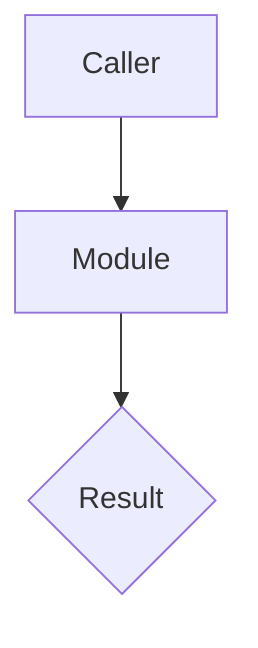

## Context

## Decision summary

## Types and interfaces

Settle these with pstack `/architect` before code. Include signatures and module boundaries.

## Diagram

Quote any mermaid label that contains a colon, slash, or parenthesis.

## Data and migrations

Name destructive migrations for H5. State the rollback. Write `none` when there is no database change.

## Risks and rollback

## Security and privacy

## Env and config

Names only. Never values.
